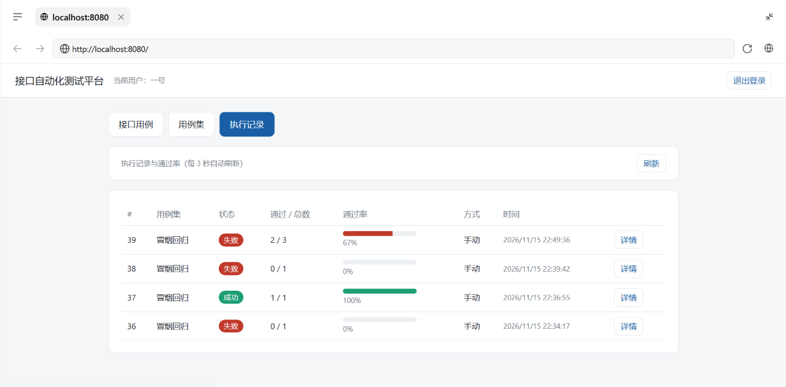

# 接口自动化测试平台（API Test Platform）



简化版的"接口测试管理 + 自动化执行"Web 平台（对标 Apifox / MeterSphere 的核心子集），采用 **Java 平台 + Python 执行引擎** 的双进程解耦架构。

> 📐 架构说明见 [docs/architecture.txt](docs/architecture.txt)

## 功能

- **用户认证**：注册 / 登录，JWT 无状态鉴权，BCrypt 密码加密
- **接口用例管理**：录入 HTTP 用例（方法 / URL / 请求头 / 请求体 / 断言 / 超时）
- **断言引擎**：状态码断言、响应体包含断言、JSON 字段断言（点路径取值 + eq / exists / contains）
- **用例集与执行**：用例编组，手动一键执行或按分钟间隔定时巡检（Spring `@Scheduled`）
- **执行报告**：每次执行落库，通过率统计、失败原因、响应预览，前端可视化展示
- **架构解耦**：平台（Spring Boot）与引擎（Python，零第三方依赖）通过 JSON 文件协议通信，引擎可独立升级或水平扩展

## 技术栈

| 层次 | 选型 |
|------|------|
| 后端 | Java 21+ / Spring Boot 3.5 / Spring Security (JWT) / Spring Data JPA / H2（默认） |
| 执行引擎 | Python 3 标准库（urllib + json），无 pip 依赖 |
| 前端 | 原生 HTML / CSS / JS 单页应用（由 Spring Boot 静态资源托管） |
| 数据库 | 默认 H2 文件库（MySQL 兼容模式），可一键切换 MySQL |

## 快速启动

前置条件：JDK 21+、Python 3.10+（`python` 命令可用）、Maven 3.9+

```bash
# 编译并运行测试
mvn package

# 启动（在项目根目录，保证 engine/runner.py 相对路径可用）
mvn spring-boot:run
# 或
java -jar target/api-test-platform-1.0.0.jar
```

打开 http://localhost:8080 ，注册账号即可使用。

> 体验接口：平台内置用例可直接测试公开靶场 https://httpbin.org （如 `GET https://httpbin.org/status/200`）。

## 切换 MySQL（可选）

修改 `src/main/resources/application.yml`：

```yaml
spring:
  datasource:
    url: jdbc:mysql://localhost:3306/test_platform?useUnicode=true&characterEncoding=utf8&serverTimezone=Asia/Shanghai
    driver-class-name: com.mysql.cj.jdbc.Driver
    username: root
    password: yourpassword
```

并把 `pom.xml` 中 `h2` 依赖替换为：

```xml
<dependency>
  <groupId>com.mysql</groupId>
  <artifactId>mysql-connector-j</artifactId>
  <scope>runtime</scope>
</dependency>
```

## 项目结构

```
api-test-platform/
├── pom.xml
├── engine/runner.py            # Python 执行引擎（JSON 文件协议）
└── src/main/
    ├── java/com/example/apitest/
    │   ├── TestPlatformApplication.java
    │   ├── controller/         # Auth / Case / Suite / Run 四个 REST 控制器
    │   ├── entity/             # User / ApiCase / TestSuite / ExecutionRun / CaseResult
    │   ├── repository/         # Spring Data JPA 仓库
    │   ├── security/           # JWT 签发解析 + 过滤器 + Spring Security 配置
    │   └── service/            # 认证 / 执行调度 / 定时扫描
    └── resources/
        ├── application.yml
        └── static/             # 前端单页应用（index.html + app.js + style.css）
```

## REST API 一览

| 方法 | 路径 | 说明 |
|------|------|------|
| POST | /api/auth/register | 注册并返回 token |
| POST | /api/auth/login | 登录并返回 token |
| GET/POST/PUT/DELETE | /api/cases | 用例 CRUD（按所有者隔离） |
| GET/POST/PUT/DELETE | /api/suites | 用例集 CRUD |
| POST | /api/suites/{id}/run | 手动触发执行（异步） |
| GET | /api/suites/{id}/runs | 用例集执行历史 |
| GET | /api/runs | 当前用户全部执行记录（轮询） |
| GET | /api/runs/{id} | 执行详情（含用例结果） |

## 已知边界与后续计划

- 引擎仅支持单次串行执行，后续可加并发执行与分布式 runner
- 断言类型可扩展：响应时间阈值、正则、前置/后置脚本
- 可增加 Postman Collection / OpenAPI 用例导入
- JWT 密钥生产环境务必通过环境变量注入
